# ecom-sre-pulse

This project simulates a real e-commerce backend to practice core SRE skills: observability, alerting, load testing, and chaos engineering.

The idea is simple. Run three microservices in Docker, instrument them with Prometheus and Grafana, generate realistic traffic, inject failures, and watch how the system behaves. Every step mirrors what an SRE does on a real team: set up monitoring, detect problems through dashboards and alerts, and recover from incidents.

This is not a production app. It is a hands-on environment built to demonstrate the detect, respond, and recover loop that SRE work is built around.

## Services

| Service         | Port | Responsibility                         |
|-----------------|------|----------------------------------------|
| Payment         | 8001 | Process and track payments             |
| Product Catalog | 8002 | Manage and serve product listings      |
| Order Service   | 8003 | Create orders, calls Payment + Catalog |

Each service is an independent Python/Flask app running in its own Docker container.

## Run the project

```bash
docker compose up -d
```

## Validate the platform

**Check all containers are running**

```bash
docker ps --filter name=ecom --format 'table {{.Names}}\t{{.Status}}\t{{.Ports}}'
```

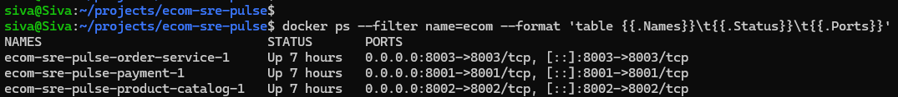

**Health checks**

Each service exposes a `/health` endpoint to confirm it is up and responding.

```bash
curl http://localhost:8001/health
```
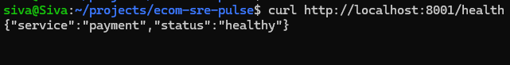

```bash
curl http://localhost:8002/health
```
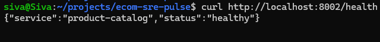

```bash
curl http://localhost:8003/health
```
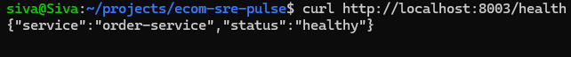

**Prometheus — All Targets UP**

Prometheus scrapes metrics from all 3 services every 15 seconds. Open `http://localhost:9090/targets` to confirm all targets are up.

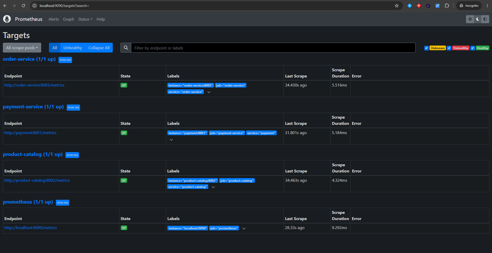

**Grafana Dashboards**

Open `http://localhost:4000`. One dashboard per service, each covering the 4 Golden Signals: Traffic, Latency, Errors, and Saturation. The screenshots below show all services healthy with live traffic before any chaos is introduced.

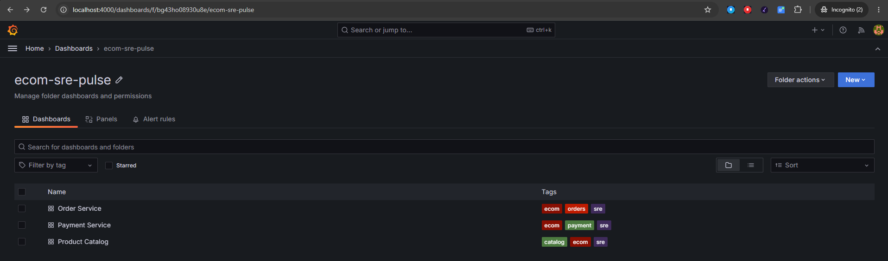

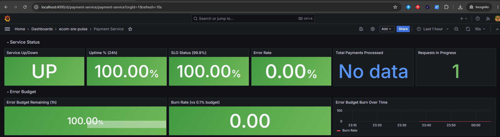
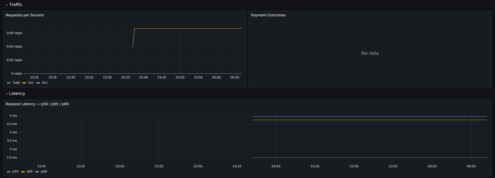
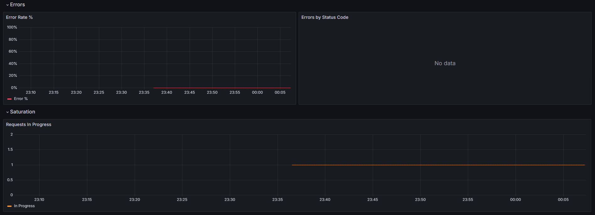


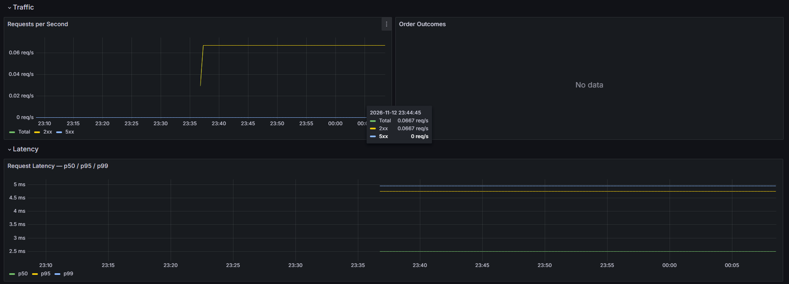
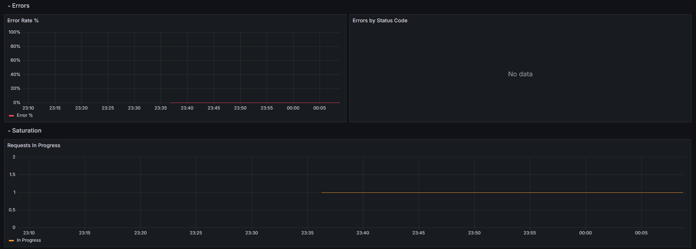

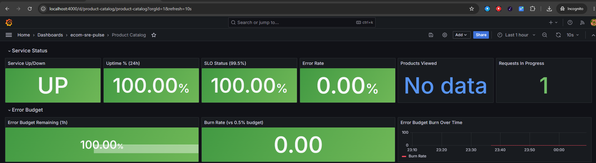
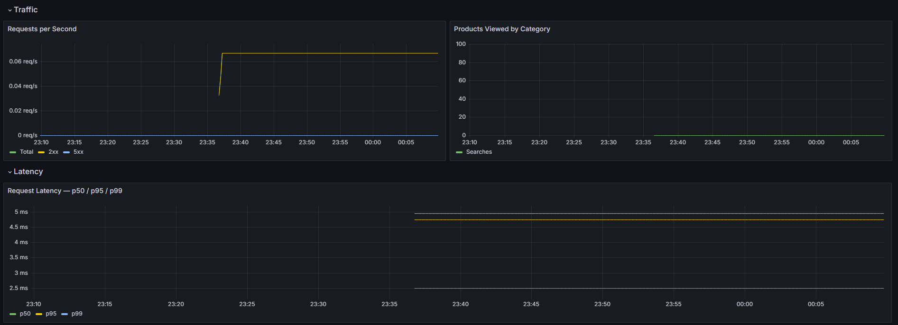
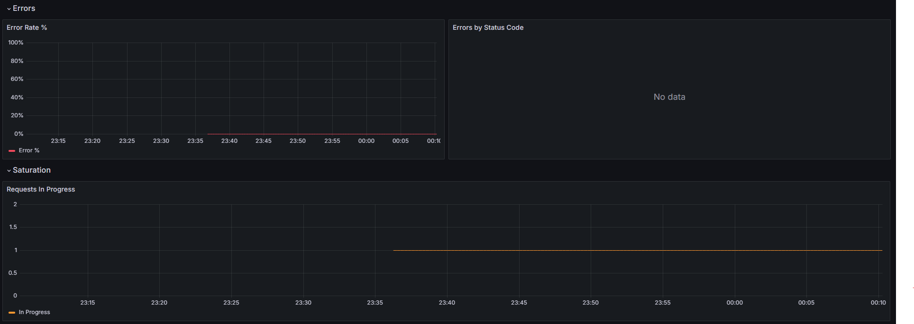

## The SRE Story

With the platform validated and running, this is a step by step walkthrough of how to generate load, trigger a failure, observe it in Grafana, and recover.

**Step 1: Start load**

Start Locust to send realistic traffic across all 3 services.

```bash
docker compose --profile load up -d load-generator
```

Open `http://localhost:8089`, set Users to 20, Ramp up to 5, and click Start.

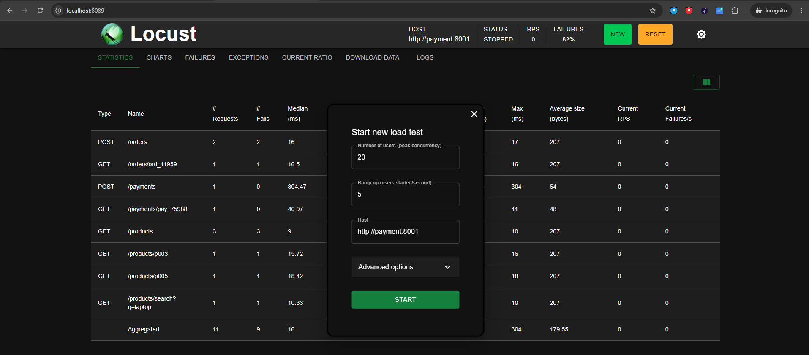

After a few seconds the results tab shows live RPS, response times, and failure counts across all 3 services.

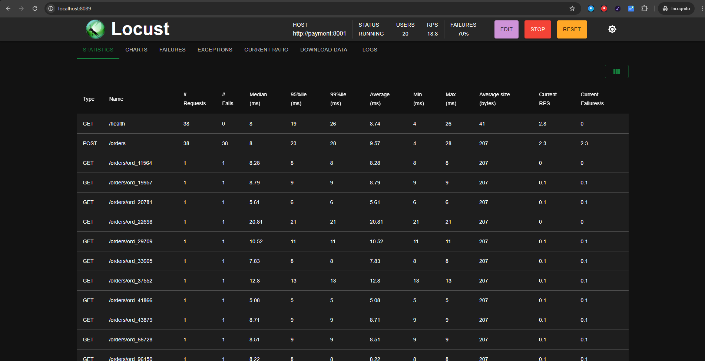

**Step 2: Inject failure**

Enable chaos on all 3 services. 60% of requests will now return 500 errors across the platform.

```bash
curl -X POST http://localhost:8001/chaos/enable
curl -X POST http://localhost:8002/chaos/enable
curl -X POST http://localhost:8003/chaos/enable
```

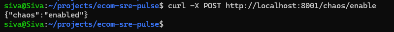

**Step 3: Observe in Grafana**

Within 15 seconds all 3 dashboards react. Error rate spikes, SLO status turns red, and the platform is visibly degraded.

Payment Service — error rate spike, SLO red


Order Service — error rate spike, order failures climbing


Product Catalog — error rate spike, SLO red


**Step 4: Alert fires**

After 2 minutes of sustained errors, Alertmanager fires the `PaymentSLOBudgetBurning` alert. View firing alerts at `http://localhost:9090/alerts`.

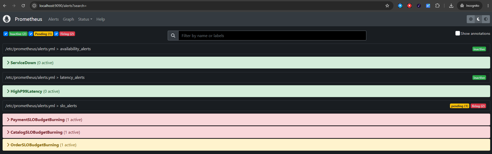

**Step 5: Recover**

Disable chaos and watch the dashboards return to green.

```bash
curl -X POST http://localhost:8001/chaos/disable
curl -X POST http://localhost:8002/chaos/disable
curl -X POST http://localhost:8003/chaos/disable
```

Error rate drops, SLO status recovers, and the alert resolves. This is the detect, respond, and recover loop that SRE on-call work is built around.

## Logs

All 3 services emit structured JSON logs on every request. Promtail collects them from Docker and ships them to Loki. Each Grafana dashboard has a Logs panel at the bottom showing live entries alongside the metrics — so when an error spike appears on the chart, you can scroll down and read exactly which requests failed.

**Normal traffic — INFO logs, all 200s**

Every request produces one log line with service name, method, path, status code, and duration in milliseconds.

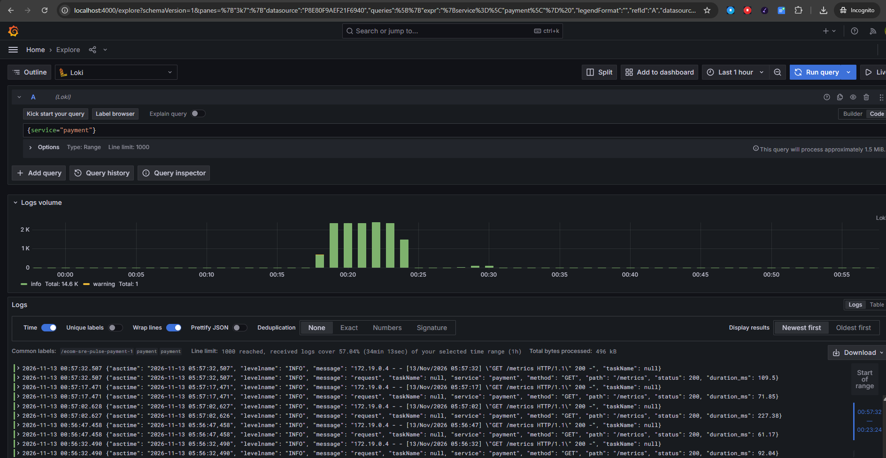

**During chaos — ERROR logs alongside the metrics spike**

Enable chaos and 500 responses start appearing in the log stream immediately. The Grafana dashboard shows the error rate climbing in the metrics panels above and the failing requests in the Logs panel below. Metrics tell you something is broken; logs tell you which endpoint and when.

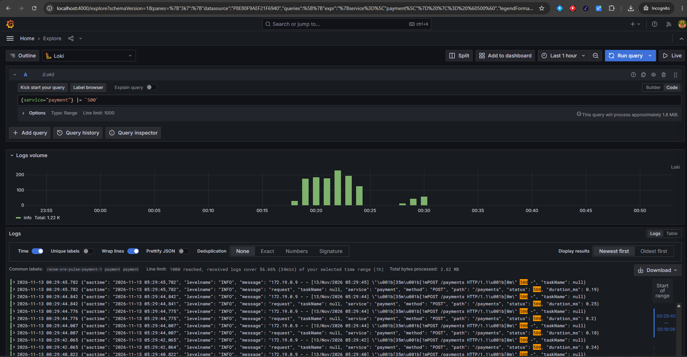


```

## Tech Stack

| Layer        | Tool                           |
|--------------|--------------------------------|
| Services     | Python 3.12 / Flask            |
| Metrics      | Prometheus + prometheus-client |
| Dashboards   | Grafana                        |
| Logs         | Loki + Promtail                |
| Alerting     | Alertmanager                   |
| Container    | Docker Compose                 |
