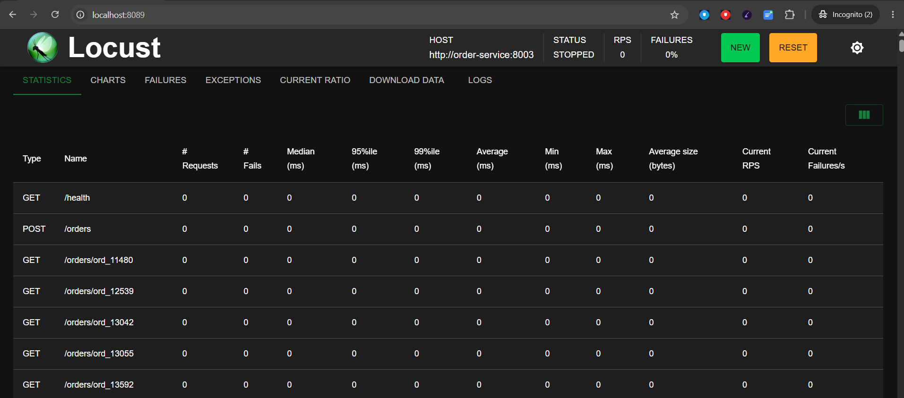

This project simulates a real e-commerce backend to practice core SRE skills: observability, alerting, load testing, and chaos engineering.

The idea is simple. Run three microservices in Docker, instrument them with Prometheus and Grafana, generate realistic traffic, inject failures, and watch how the system behaves. Every step mirrors what an SRE does on a real team: set up monitoring, detect problems through dashboards and alerts, and recover from incidents.

This is not a production app. It is a hands-on environment built to demonstrate the detect, respond, and recover loop that SRE work is built around.

## Services

| Service         | Port | Responsibility                         |
|-----------------|------|----------------------------------------|
| Payment         | 8001 | Process and track payments             |
| Product Catalog | 8002 | Manage and serve product listings      |
| Order Service   | 8003 | Create orders, calls Payment + Catalog |

Each service is an independent Python/Flask app running in its own Docker container.

## Run the project

```bash
docker compose up -d
```

## Validate the platform

**Check all containers are running**

```bash
docker ps --filter name=ecom --format 'table {{.Names}}\t{{.Status}}\t{{.Ports}}'
```


**Health checks**

Each service exposes a `/health` endpoint to confirm it is up and responding.

```bash
curl http://localhost:8001/health
```


```bash
curl http://localhost:8002/health
```


```bash
curl http://localhost:8003/health
```


**Prometheus — All Targets UP**

Prometheus scrapes metrics from all 3 services every 15 seconds. Open `http://localhost:9090/targets` to confirm all targets are up.


**Grafana Dashboards**

Open `http://localhost:4000`. One dashboard per service, each covering the 4 Golden Signals: Traffic, Latency, Errors, and Saturation.


## The SRE Story

With the platform validated and running, this is a step by step walkthrough of how to generate load, trigger a failure, observe it in Grafana, and recover.

**Step 1: Start load**

Start Locust to send realistic traffic across all 3 services.

```bash
docker compose --profile load up -d load-generator
```

Open `http://localhost:8089`, set Users to 20, Ramp up to 5, and click Start.



**Step 2: Inject failure**

Enable chaos on the Payment service. 60% of payment requests will now return 500 errors.

```bash
curl -X POST http://localhost:8001/chaos/enable
```

**Step 3: Observe in Grafana**

Open the Payment Service dashboard at `http://localhost:4000/d/payment-service`.

Within 15 seconds you will see the error rate panel spike, the SLO status turn red, and the Order Service dashboard show payment failures climbing.

**Step 4: Alert fires**

After 2 minutes of sustained errors, Alertmanager fires the `PaymentSLOBudgetBurning` alert.

**Step 5: Recover**

Disable chaos and watch the dashboards return to green.

```bash
curl -X POST http://localhost:8001/chaos/disable
```

Error rate drops, SLO status recovers, and the alert resolves. This is the detect, respond, and recover loop that SRE on-call work is built around.

## Tech Stack

| Layer        | Tool                           |
|--------------|--------------------------------|
| Services     | Python 3.12 / Flask            |
| Metrics      | Prometheus + prometheus-client |
| Dashboards   | Grafana                        |
| Logs         | Loki + Promtail                |
| Alerting     | Alertmanager                   |
| Container    | Docker Compose                 |
